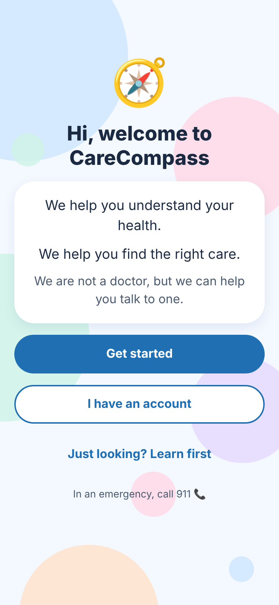
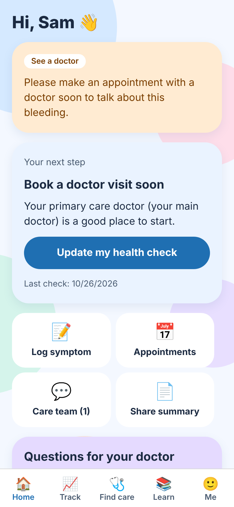
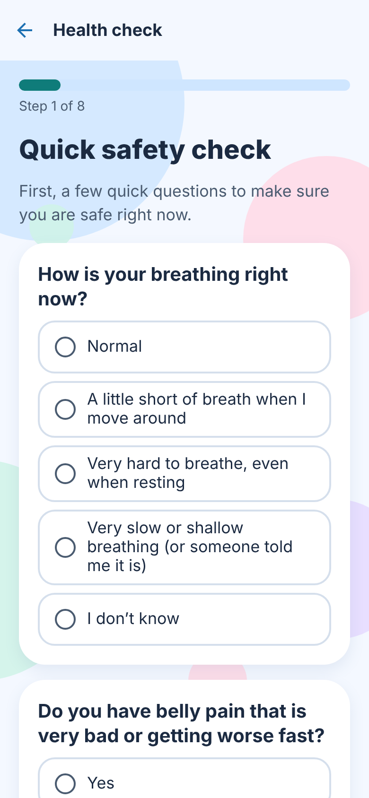
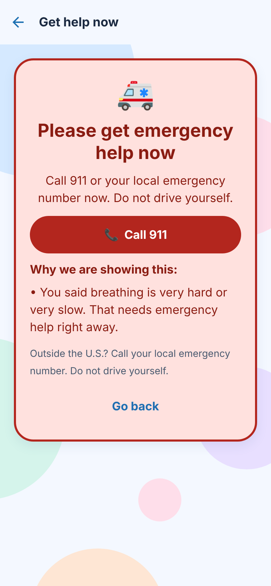
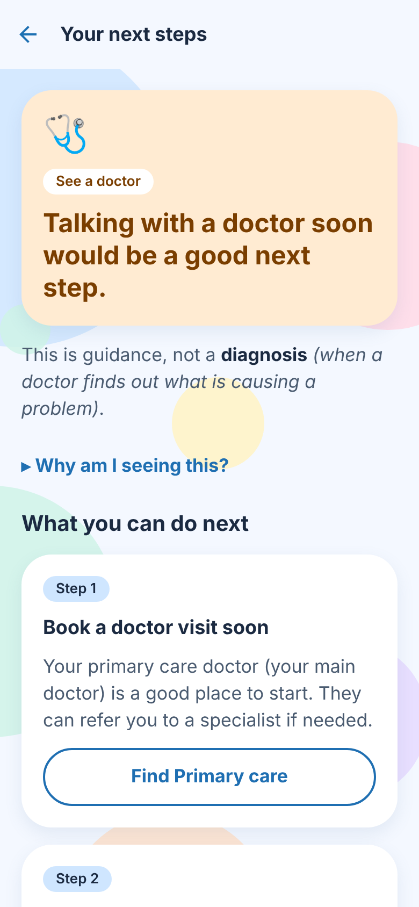
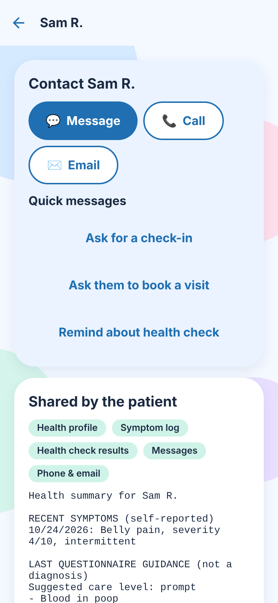

# CareCompass

CareCompass is a mobile app for people affected by colorectal cancer and other cancers. That includes people who have cancer, are worried about symptoms, may be at higher risk, are in treatment, are survivors, or are caring for someone.

It helps people:

- understand their next steps (without being diagnosed),
- organize their health information,
- read trustworthy, easy-to-read education,
- find suitable specialists, and
- connect with their own clinician securely.

> **CareCompass is an educational and care-navigation tool. It does not diagnose, predict cancer, or prescribe.**
> The triage rules are a **draft** and must be reviewed and signed off by qualified clinicians before anyone relies on them. See [docs/CLINICAL_REVIEW.md](docs/CLINICAL_REVIEW.md).

| Welcome | Dashboard | Safety check | Emergency | Results | Clinician view |
|---|---|---|---|---|---|
|  |  |  |  |  |  |

---

## Architecture at a glance

```
mobile/   React Native (Expo SDK 58) + TypeScript
          React Navigation · React Hook Form + Zod · expo-secure-store
             │  HTTPS / JSON (Bearer access token, rotating refresh token)
             ▼
backend/  Node.js 22 + Express 5 + TypeScript
          Zod validation · Argon2id · JWT · helmet · rate limiting · pino
          ├── modules/questionnaire   versioned, branching questionnaire definition
          ├── modules/triage          deterministic safety rules engine (versioned)
          ├── modules/recommendations medication + comfort safety checks, result cards
          └── routes/                 REST API, documented in openapi/openapi.yaml
             ▼
MongoDB   Mongoose models with validation, indexes, TTL retention

tools/    Python: clinical-review packet generator (stdlib only)
```

There's more detail in [docs/ARCHITECTURE.md](docs/ARCHITECTURE.md).

**About the language:** the brief asked for Python as the main language, but it also specified React Native, Node/Express and TypeScript for every layer. The app follows the detailed stack. Python is used for the clinical-review tooling (`tools/`).

---

## Project structure

```
carecompass/
├── README.md
├── docker-compose.yml              MongoDB + API for local development
├── .github/workflows/ci.yml        typecheck, unit + integration tests, build
├── docs/
│   ├── ARCHITECTURE.md
│   ├── CLINICAL_REVIEW.md          what clinicians must review before launch
│   ├── SECURITY_PRIVACY.md         controls, data retention, HIPAA considerations
│   ├── PRIVACY_POLICY_DRAFT.md     plain-language draft (needs legal review)
│   ├── EXTERNAL_SERVICES.md        integrations that need credentials
│   ├── DEPLOYMENT.md
│   └── screenshots/
├── tools/
│   ├── clinical_review.py          builds a review packet (Markdown + CSV)
│   └── test_clinical_review.py
├── backend/
│   ├── .env.example
│   ├── Dockerfile
│   ├── openapi/openapi.yaml        OpenAPI 3.1 spec (served at /api/docs)
│   ├── src/
│   │   ├── app.ts / server.ts
│   │   ├── config/                 env validation, logger (redacting), db
│   │   ├── middleware/             auth, validation, sanitize, rate limits, errors
│   │   ├── models/                 User, HealthProfile, Questionnaire, SymptomEntry,
│   │   │                           TriageResult, Provider, SavedProvider,
│   │   │                           EducationalResource, Appointment, CareConnection,
│   │   │                           Message, AuditLog, RefreshToken, PasswordReset
│   │   ├── modules/
│   │   │   ├── questionnaire/      definition.ts, branching.ts, types.ts
│   │   │   ├── triage/             facts.ts, rules.ts, indicators.ts, engine.ts
│   │   │   └── recommendations/    medication.ts, comfort.ts, engine.ts
│   │   ├── routes/                 auth, users, healthProfile, questionnaires, triage,
│   │   │                           symptoms, providers, resources, appointments,
│   │   │                           connections (clinician ↔ patient), dashboard, admin
│   │   ├── services/               tokens, email, audit, summary, providerDirectory
│   │   ├── scripts/                exportClinicalContent.ts
│   │   └── seed/                   seed.ts + demo providers + educational resources
│   └── tests/
│       ├── unit/                   triage, branching, recommendations, HTTP, OpenAPI coverage
│       └── integration/            auth, isolation & deletion, end-to-end flows (MongoDB)
└── mobile/
    ├── .env.example
    ├── App.tsx
    ├── src/
    │   ├── api/                    fetch client with token refresh, types
    │   ├── auth/                   AuthContext
    │   ├── components/             BubbleBackground, ui, forms, health
    │   ├── content/glossary.ts     plain-language definitions
    │   ├── navigation/             role-based navigation (signed-out / patient / clinician)
    │   ├── questionnaire/          QuestionField + shared branching (copy of backend)
    │   └── screens/                auth/, patient/, clinician/, shared/
    └── __tests__/
```

---

## Quick start

### Prerequisites

- Node.js 22.13 or newer, and npm
- MongoDB 7 or newer (local install, Docker, or MongoDB Atlas)
- For the mobile app: the Expo Go app on a phone, or an iOS simulator or Android emulator
- Optional: Python 3.10 or newer, for `tools/`

### 1. Database

```bash
docker compose up -d mongo          # or use your own MongoDB
```

### 2. Backend

```bash
cd backend
cp .env.example .env                # then set JWT_ACCESS_SECRET (see the comment in the file)
npm install
npm run seed                        # indexes + resources + DEMO providers + demo accounts
npm run dev                         # http://localhost:4000  ·  API docs: http://localhost:4000/api/docs
```

Demo accounts are created only outside production. The password for all of them is `DemoPass2026`.

| Role | Email |
|---|---|
| Patient | `patient@demo.carecompass.test` |
| Clinician (verified) | `clinician@demo.carecompass.test` |
| Admin | `admin@demo.carecompass.test` |

### 3. Mobile app

```bash
cd mobile
cp .env.example .env                # set EXPO_PUBLIC_API_URL for your device/emulator
npm install
npm start                           # press i (iOS), a (Android), or scan the QR code with Expo Go
```

### 4. Try the clinician connection

1. Sign in as the patient. Go to **Me → Care team**, pick what to share and tap **Get my share code**.
2. Sign in as the clinician on another device or simulator, enter the code under **My patients**, then message or call the patient.

---

## Environment variables

**Backend (`backend/.env`):**

| Variable | Required | Purpose |
|---|---|---|
| `MONGODB_URI` | ✓ | MongoDB connection string |
| `JWT_ACCESS_SECRET` | ✓ | At least 32 random characters, used to sign access tokens |
| `NODE_ENV` | | `development` / `test` / `production` |
| `PORT` | | Default `4000` |
| `CORS_ORIGINS` | | Comma-separated browser origins (native apps don't need CORS) |
| `ACCESS_TOKEN_TTL` | | Default `15m` |
| `REFRESH_TOKEN_TTL_DAYS` | | Default `30` |
| `PASSWORD_RESET_URL` | | Link put in reset emails (deep link or web page) |
| `PASSWORD_RESET_TTL_MINUTES` | | Default `30` |
| `EMAIL_PROVIDER` | | `console` (development) or `smtp`. SMTP needs `SMTP_*` and an implementation; see [EXTERNAL_SERVICES](docs/EXTERNAL_SERVICES.md) |
| `TRUST_PROXY` | | `true` when running behind a TLS-terminating proxy (required for the HTTPS check) |
| `ENABLE_API_DOCS` | | Serve Swagger UI in production |
| `LOG_LEVEL` | | pino level (`info`, `warn`, `silent`, …) |
| `AUDIT_LOG_RETENTION_DAYS` | | Default `2190` (6 years) |
| `SHARE_CODE_TTL_HOURS` | | How long a patient's share code works. Default `24` |
| `AI_PROVIDER` | | Only `disabled` is supported (see [Section 9 guardrails](docs/EXTERNAL_SERVICES.md#ai-explanation-layer-optional)) |

**Mobile (`mobile/.env`):** `EXPO_PUBLIC_API_URL` and `EXPO_PUBLIC_EMERGENCY_NUMBER` (default `911`).

---

## Tests

```bash
cd backend
npm run test:unit                   # 179 tests, no database needed
npm run test:integration            # 43 tests; needs MongoDB: uses mongodb-memory-server, or set MONGODB_TEST_URI
npm test                            # everything

cd ../mobile && npm test            # 26 tests (React Native Testing Library)
cd .. && python3 -m unittest discover tools
```

What the tests cover:

- **Safety engine:** every emergency rule; severe signs win over a low pain score; "I don't know" on a safety question leads to prompt care; missing answers lead to "insufficient information" (never a reassuring result); the output never says "cancer-free"; the engine is deterministic.
- **Branching:** comfort-measure skip logic, answers hidden by branching are removed, and the definition stays intact.
- **Validation:** severity must be 1–10 or N/A; unknown questions, bad choices, future dates and text that's too long are rejected.
- **Medication:** allergies (including in free text and the saved profile), liver disease, alcohol, other acetaminophen products, age, being in treatment, clinician instructions; no dose is ever shown.
- **Comfort measures:** heat, cold and massage are blocked for surgery, fragile skin, numbness, blood thinners, devices, bleeding disorders and unknown answers.
- **API (integration):** registration and consent, login, refresh-token rotation and reuse detection, password reset, cross-user isolation (IDOR), operator-injection attempts, role checks, account and data deletion, data export, questionnaire flow including immediate emergency detection, provider filters and verification, saved providers, resources, clinician connections (scopes, revocation, audit), and the error format.
- **HTTP (no DB):** auth guards, security headers, oversized and malformed bodies, and every Express route documented in OpenAPI.
- **Mobile:** welcome brevity, onboarding multi-select, login validation, the questionnaire's immediate emergency navigation, required answers, progress and branching, results disclaimers and never "cancer-free", the emergency call button, role-based navigation, the `Term` definitions and `SeverityScale` accessibility.

---

## Deployment

See [docs/DEPLOYMENT.md](docs/DEPLOYMENT.md). In short:

- build the backend Docker image;
- run it behind TLS with `TRUST_PROXY=true`, using managed MongoDB with auth and encryption;
- load secrets from a secret manager;
- run `npm run seed:prod-safe` to load content only, never demo data;
- build the mobile app with EAS Build and set `EXPO_PUBLIC_API_URL` to an HTTPS URL.

## Known limitations

- **Clinical content is a draft.** Rules, wording and resource summaries need clinician sign-off.
- **Unchecked source links.** The educational source links could not be checked from the build environment (outbound access blocked). Run `tools/clinical_review.py --check-links`.
- **Email isn't delivered** (console mode). Users paste the reset code manually until SMTP and deep links are configured.
- **Directory data is fictional.** Provider directory data is demonstration-only. Location search uses ZIP prefixes, not distance.
- **No real-time features.** Messages aren't pushed in real time (they update on screen focus), and push notifications aren't implemented.
- **Basic mobile inputs.** Date and time are typed text (no native picker), to keep dependencies minimal.
- **English only.** `preferredLanguage` is stored but there are no translations yet.
- **No admin UI.** Admin tools are available through the API only.
- **Changing step count.** The questionnaire progress count grows when follow-up sections appear (e.g. "Step 1 of 8" becomes "of 10").

## Before a public launch

Read these:

- [docs/CLINICAL_REVIEW.md](docs/CLINICAL_REVIEW.md): every rule, message and question needs clinical sign-off.
- [docs/SECURITY_PRIVACY.md](docs/SECURITY_PRIVACY.md): security review, penetration test, HIPAA and state-law assessment, and a BAA with every vendor that touches health data.
- [docs/EXTERNAL_SERVICES.md](docs/EXTERNAL_SERVICES.md): email, provider directory, geocoding, push notifications, booking and telehealth.

No regulatory compliance (HIPAA or otherwise) is claimed.
